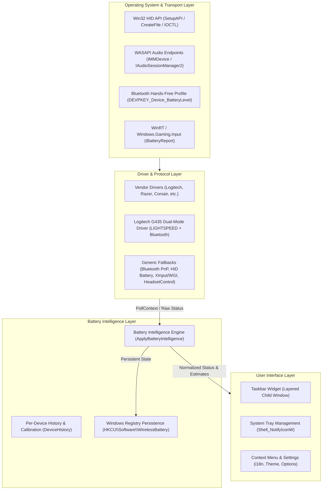
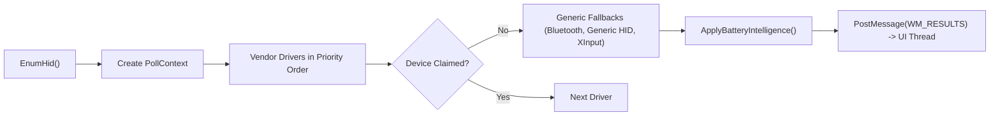
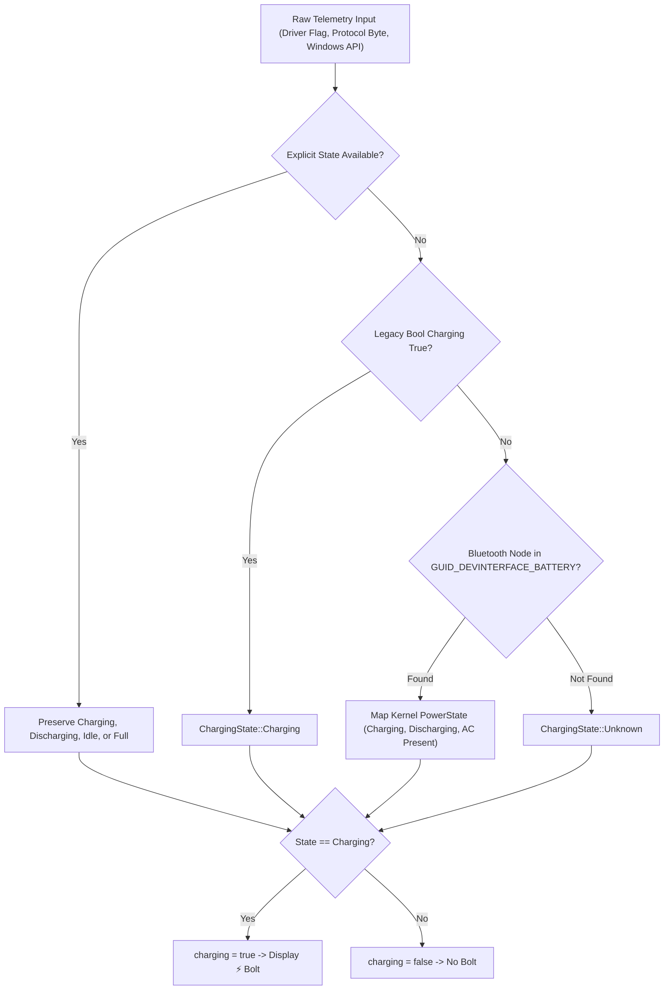
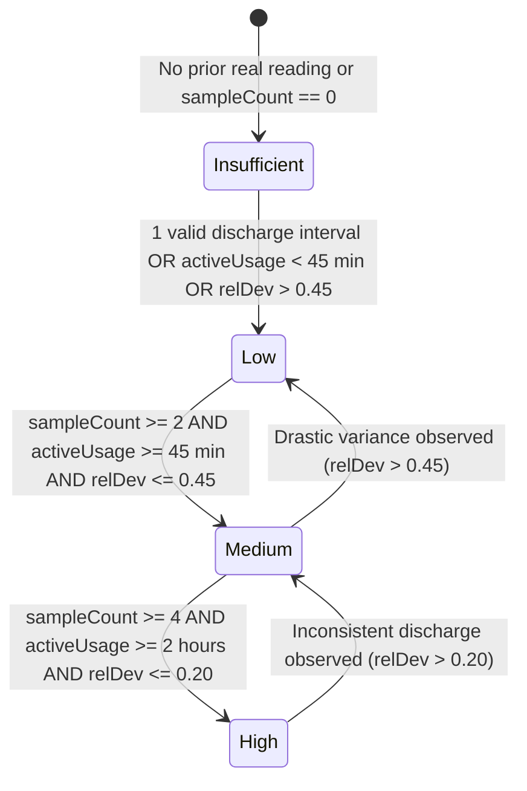
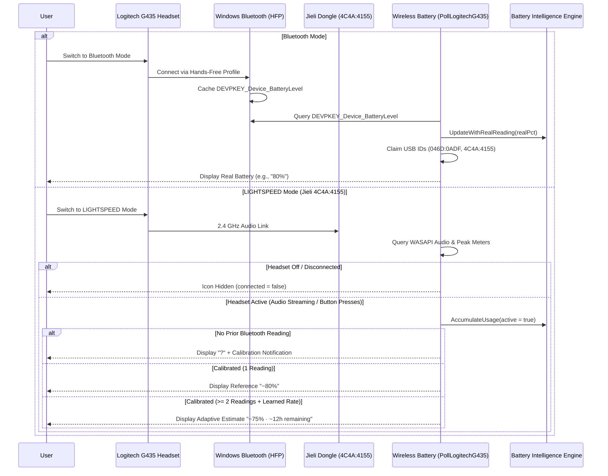
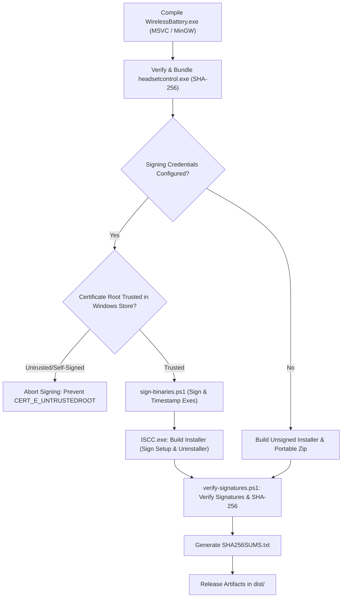

# Architecture Documentation

This document describes the architectural design, internal pipelines, and engineering implementations of **Wireless Device Battery Monitor** (with fork enhancements from `Peagasss/Wireless-Device-Battery-Monitor-PTBR`).

---

## 1. High-Level Architecture Overview

Wireless Device Battery Monitor is a lightweight, native C++17 Windows desktop application designed to report peripheral battery levels on the taskbar or system tray without background services, heavy runtimes, or vendor bloatware.

The application is structured into four decoupled layers:



---

## 2. Device Polling Pipeline

Polling runs asynchronously on a dedicated worker thread ([`Worker`](file:///c:/Users/pedro/OneDrive/Documentos/Wireless-Device-Battery-Monitor-main/src/main.cpp#L624-L633)) every 60 seconds (or 30s/2m/5m based on user settings), as well as immediately upon device arrival/removal (`WM_DEVICECHANGE`) or system resume (`WM_POWERBROADCAST`).

### 2.1. Discovery and Priority Order

The entry point is [`PollAllDevices()`](file:///c:/Users/pedro/OneDrive/Documentos/Wireless-Device-Battery-Monitor-main/src/devices.cpp#L10-L65):



1. **HID Enumeration:** [`EnumHid()`](file:///c:/Users/pedro/OneDrive/Documentos/Wireless-Device-Battery-Monitor-main/src/hid.cpp#L10-L38) enumerates all active HID collections and retrieves report lengths (`caps.InputReportByteLength`, `caps.FeatureReportByteLength`).
2. **Vendor Drivers First:** Vendor-specific drivers run in a predetermined sequence to avoid hardware probing conflicts. For example:
   - `PollAula` runs before `PollKysona` (both share vendor ID `0x3554`).
   - `PollAtkBitmouse` runs before `PollKysona` to prevent sending the wrong query format to NearLink dongles.
   - `PollLogitechG435` runs before `PollLogitech` to handle the dual-mode G435 identity before general HID++ probing.
   - `PollAirPods` and `PollGalaxyBuds` run before generic Bluetooth fallback.
3. **Claiming Mechanism:** When a driver successfully communicates with a receiver or device, it calls `ctx.Claim(vid, pid)` or `ctx.Add(status, vid, pid)`. Claimed devices are ignored by subsequent drivers and generic fallbacks.
4. **Bluetooth Fallback & Generic HID:** Unclaimed devices are checked against Windows Bluetooth device properties (`DEVPKEY_Device_BatteryLevel`) and standard HID battery usage reports (`UsagePage 0x06, Usage 0x20` or `UsagePage 0x85, Usage 0x65`).

---

## 3. Battery Intelligence Engine

The **Battery Intelligence Engine** ([`src/battery_intelligence.h`](file:///c:/Users/pedro/OneDrive/Documentos/Wireless-Device-Battery-Monitor-main/src/battery_intelligence.h), [`src/battery_intelligence.cpp`](file:///c:/Users/pedro/OneDrive/Documentos/Wireless-Device-Battery-Monitor-main/src/battery_intelligence.cpp)) is a centralized processing layer executed at the conclusion of every poll cycle via `ApplyBatteryIntelligence()`.

### 3.1. Universal Charging State Model

To eliminate discrepancies between drivers, the engine normalizes all device telemetry into a standardized 5-state model:



| State | Definition | Visual Indicator | Runtime Estimation |
| :--- | :--- | :--- | :--- |
| `Charging` | Battery is actively receiving charge from external power | `⚡` displayed | Suppressed (`-1`) |
| `Discharging` | Device is running on battery power | Normal display | Active calculation |
| `Idle` | Connected to external power; charge paused / maintaining | Normal display | Suppressed (`-1`) |
| `Full` | Battery is 100% full and plugged into external power | Normal display | Suppressed (`-1`) |
| `Unknown` | Device/protocol does not provide reliable charging data | Normal display | Calculated from battery drop |

> [!IMPORTANT]
> The engine strictly prohibits inferring `ChargingState::Charging` from a rising battery percentage between polls or from mere USB receiver connection. Charging is confirmed only when hardware registers or OS battery APIs report active charging.

### 3.2. Consumption Rate Learning (EMA)

When a device is running on battery power, the engine monitors its discharge rate (% drop per hour of confirmed active use):

1. **Active Usage Tracking (`AccumulateUsage`):**
   - Active usage seconds (`activeUsageSec`) accumulate strictly when the device is connected, awake, in use, and not charging.
   - For drivers reporting explicit activity (such as G435 WASAPI audio playback or HID button presses), activity is tracked directly.
   - When per-device activity telemetry is unavailable, system user input activity (`GetLastInputInfo`) prevents accumulating usage while the user is away from the PC.
2. **Learning Thresholds & Sanity Bounds:**
   - Minimum accumulated active usage required before calculating an observed discharge rate: **10 minutes (600 seconds)** (`kMinLearningUsageSec`).
   - Maximum poll step considered contiguous active usage: **10 minutes** (`kMaxPollStepSec`).
   - Realistic peripheral discharge bounds: **0.2%/hour to 50.0%/hour** (`kMinRatePctPerHr` to `kMaxRatePctPerHr`).
3. **Exponential Moving Average (EMA):**
   Upon observing a real battery decrease ($\Delta P \ge 1\%$) over active hours ($H = \Delta t_{\text{active}} / 3600$):
   $$R_{\text{obs}} = \frac{\Delta P}{H}$$
   If a prior learned rate exists:
   $$R_n = 0.70 \times R_{n-1} + 0.30 \times R_{\text{obs}}$$
   $$D_n = 0.70 \times D_{n-1} + 0.30 \times |R_{\text{obs}} - R_{n-1}|$$
   Where $R_n$ is the smoothed rate and $D_n$ is the smoothed mean absolute deviation.
4. **Unmonitored Gap Protection:**
   If the device was disconnected, sleeping, or the PC was powered down for more than 15 minutes (`kMaxUnmonitoredGapSec = 900 s`), the engine marks `unmonitoredGap = true`. Any battery drop observed across that gap updates the reference percentage (`lastRealPercent`) without distorting the learned active discharge rate.

### 3.3. Remaining Runtime Calculation

Remaining runtime in minutes is calculated from the available percentage and the learned consumption rate:

$$\text{Runtime (hours)} = \frac{\text{Effective Battery Percentage}}{R_n\text{ (\%/hour)}}$$

$$\text{Runtime (minutes)} = \text{round}(\text{Runtime (hours)} \times 60)$$

- Clamped between 1 and 60,000 minutes.
- Returns `-1` (suppressed) if the device is charging, fully charged on external power, or if confidence is `Insufficient`.

### 3.4. Multi-Tier Statistical Confidence

The engine assigns a confidence level based on observational consistency:



- **`Insufficient`:** History is inadequate to estimate runtime. The UI displays `autonomia indisponível` (`runtime unavailable`).
- **`Low`:** Preliminary estimate from 1 sample or high variance between observations.
- **`Medium`:** Reliable estimate based on multiple consistent intervals ($\ge 45\text{ min}$ cumulative usage).
- **`High`:** Highly stable estimate based on $\ge 4$ intervals, $\ge 2\text{ hours}$ of tracked active usage, and relative deviation $\le 20\%$.

---

## 4. Windows Registry Persistence Architecture

To survive application restarts and disconnections without cross-device contamination, device histories are stored under isolated subkeys:

```
HKEY_CURRENT_USER\Software\WirelessBattery\Devices\
  ├── g435\
  ├── hid_046d_c547#1\
  ├── logi_unit_a1b2c3d4\
  └── bt_{guid}\
```

### 4.1. Sanitization & Collision Prevention

Device keys (which may contain colons, GUID braces, or path hashes) are sanitized into valid Win32 Registry key names via [`SanitizeRegistrySubkey`](file:///c:/Users/pedro/OneDrive/Documentos/Wireless-Device-Battery-Monitor-main/src/battery_intelligence.cpp#L25-L53):
- Alphanumeric characters, hyphens, and periods are preserved in lowercase.
- Non-alphanumeric characters are mapped to underscores.
- An FNV-1a 32-bit hash suffix (`_xxxxxxxx`) is appended whenever characters are modified or truncated to guarantee uniqueness.

### 4.2. Persisted Attributes

Each subkey persists:
- `DeviceKey` (`REG_SZ`): Raw original device key for identification.
- `Calibrated` (`REG_DWORD`): `1` if at least one real battery reading has been recorded.
- `PromptShown` (`REG_DWORD`): `1` if a first-time calibration prompt has been issued.
- `LastRealPercent` (`REG_DWORD`): Most recent confirmed real battery level (`0..100`).
- `LastRealTimestampSec` (`REG_QWORD`): Unix epoch seconds of `LastRealPercent`.
- `ActiveUsageSec` (`REG_QWORD`): Active usage seconds accumulated since `LastRealPercent`.
- `TotalLearnedUsageSec` (`REG_QWORD`): Total historical active seconds incorporated into the rate.
- `LearnedRateMilliPctPerHr` (`REG_DWORD`): Learned rate in thousandths of a percent per hour ($0.001\%/\text{h}$).
- `RateDeviationMilliPctPerHr` (`REG_DWORD`): Rate deviation in thousandths of a percent per hour.
- `SampleCount` (`REG_DWORD`): Count of incorporated learning intervals.
- `LastPollTimestampSec` (`REG_QWORD`): Timestamp of prior poll step.
- `UnmonitoredGap` (`REG_DWORD`): Flag indicating an offline or unmonitored interval.

### 4.3. Backward Compatibility & Migration

For the Logitech G435 (`key = "g435"`), the engine maintains automatic non-destructive migration and bi-directional synchronization with `HKCU\Software\WirelessBattery\G435`, ensuring full backward compatibility with previous versions.

---

## 5. Logitech G435 Dual-Mode Implementation

The Logitech G435 is a dual-mode wireless gaming headset supporting both LIGHTSPEED (via USB receiver `A00150`) and Bluetooth.



### 5.1. Unified Logical Identity

Both modes share the stable key `L"g435"`. When connected via Bluetooth:
- The driver claims USB vendor IDs `0x046D:0x0ADF` and `0x4C4A:0x4155` so a plugged-in USB receiver does not generate a secondary device entry.
- The Bluetooth container ID is registered in `ctx.btContainers` so generic Bluetooth polling does not duplicate the entry.

### 5.2. Jieli Receiver (`4C4A:4155`) Connection & Activity Verification

Unlike the Holtek `046D:0ADF` receiver (which tunnels Airoha `GET_BATTERY` commands over vendor collection `0xFF00:0001`), the Jieli `4C4A:4155` receiver provides no direct battery polling interface over its USB HID collection (`000C:0001`).

Furthermore, the Jieli USB receiver keeps its USB Audio and HID interfaces statically enumerated in Windows even when the headset is turned off. Therefore, connection and active usage are determined dynamically:
1. **WASAPI Audio Session & Meter Activity (`QueryG435UsbAudioActivity`):** Inspects Windows audio endpoints matching `"Logitech G435"` (excluding Bluetooth Hands-Free endpoints) via `IMMDeviceEnumerator`, querying `IAudioSessionControl::GetState() == AudioSessionStateActive` and `IAudioMeterInformation::GetPeakValue() > 0.0001f`.
2. **Passive Interrupt IN Listener (`JieliHidMonitorThread`):** A lightweight background thread monitors `EP 0x82` on `4C4A:4155` (`000C:0001`, 3-byte input reports), recording timestamps of volume button presses.
3. **Connection Visibility Rule:** If neither audio sessions, peak audio, button events, nor recent mode transitions are detected, `connected` is set to `false` and the headset is omitted from the UI. Battery is never discounted while the headset is off or disconnected.

---

## 6. Automated Testing Architecture

Testing is split into isolated unit test suites that verify protocol decoders, estimation algorithms, and state machines without requiring physical hardware:

```
tests/
  ├── battery_intelligence_test.cpp    # Full test suite for the Battery Intelligence Engine
  ├── logitech_g435_0adf_test.cpp      # G435 CRC-16 frames, voltage curves & G435 estimator
  ├── rapoo_protocol_test.cpp          # Rapoo VT status frame decoders & bounds checking
  ├── galaxy_buds_protocol_test.cpp    # Samsung Galaxy Buds RFCOMM frame parsers
  ├── steelseries_mouse_test.cpp       # SteelSeries driver simulation & battery parsing
  ├── rapoo_driver_test.cpp            # Rapoo driver HID mock transport
  ├── ninjutso_driver_test.cpp         # Ninjutso driver HID mock transport
  ├── vaxee_driver_test.cpp            # VAXEE driver HID mock transport
  ├── keychron_driver_test.cpp         # Keychron driver HID mock transport
  ├── dareu_driver_test.cpp            # DAREU driver HID mock transport
  └── steelseries_driver_test.cpp      # SteelSeries driver HID mock transport
```

### 6.1. Verification Coverage

- **Protocol Tests:** Pass captured raw byte arrays through parser functions to assert correct percentage, millivolts, and charging flags under normal, empty, and malformed conditions.
- **Mock Transport Driver Tests:** Replace Win32 HID APIs (`CreateFileW`, `HidD_GetFeature`, `ReadFile`) with queued synthetic report buffers to verify driver discovery, packet parsing, deduplication, and timeout resilience.
- **Battery Intelligence Tests:** Verify 12 functional scenarios:
  1. Charging state normalization.
  2. Absence of charging information (ensuring `Unknown` is never assumed to be discharging or charging).
  3. Single-reading calibration (ensuring a single reading never defines a consumption rate).
  4. Runtime estimation math and unit scaling.
  5. Suppression of runtime estimates during charging.
  6. Transition between charging and discharging.
  7. Recharging without an explicit charging flag (rising percentage recalibrates reference without rate corruption).
  8. Unmonitored gap protection (long sleep / offline drops do not distort the active rate).
  9. Confidence level progression (`Insufficient` $\rightarrow$ `Low` $\rightarrow$ `Medium` $\rightarrow$ `High`).
  10. Recalibration and adaptation upon increased consumption variance.
  11. Strict state isolation between different device keys.
  12. Real Windows Registry persistence round-trip and subkey cleanup.

---

## 7. Code Signing & Distribution Pipeline

To prepare the application for public distribution without triggering Windows Smart App Control (SAC) blocks or Windows Defender SmartScreen warnings, the build system incorporates an automated Authenticode signing pipeline:



### 7.1. Smart App Control Considerations

- **Untrusted Roots:** Signing with a self-signed certificate generates `CERT_E_UNTRUSTEDROOT` under `WinVerifyTrust`, causing Smart App Control in Enforced mode to block process creation. The signing script explicitly builds and tests the certificate chain (`X509Chain.Build`) and refuses to sign with untrusted certificates.
- **Trusted CA Requirements:** Production signing requires an Authenticode certificate rooted in the **Microsoft Trusted Root Program** (e.g., Microsoft Trusted Signing, DigiCert, Sectigo, GlobalSign, or SignPath.io for open-source projects).
- **Execution Policy:** When signing credentials are not configured, the packaging pipeline proceeds unsigned and outputs `[SIGNING SKIPPED] ... Binaries remain UNSIGNED`, ensuring automated builds remain transparent about their signing status.
